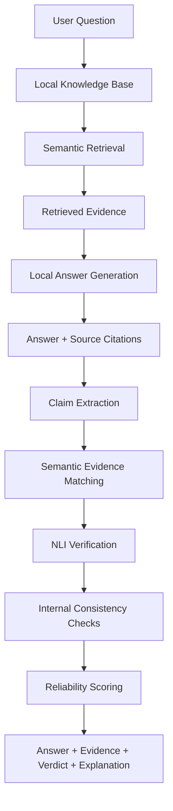

VERIDEX
Self-Verifying Local AI Knowledge Assistant
Retrieval provides knowledge. Verification provides trust.

VERIDEX is a proposed local-first AI knowledge assistant designed to answer questions using institutional data and independently verify generated claims against retrieved evidence. It combines two hackathon problem statements into one pipeline:
- PS7 — Local Database Question-Answering System
- PS2 — AI Reliability / Hallucination Verification
Event: HackWithAMYPO National Hackathon 2026
Progress: Advanced to Stage 2
Team Lead: Allan Paulraj V
AI/ML Teammate: Tivin Elvis PJ
Mentor: Dr D Darling Jemima
Table of Contents
- Overview
- The Problem
- Proposed Solution
- How It Works
- Key Features
- Architecture
- Technology Stack
- Problem Statement Mapping
- Team Contributions
- Project Status
- Planned API
- Proposed Repository Structure
- Constraints and Design Goals
- Limitations and Future Work
- Acknowledgements
Overview
AI assistants can produce fluent answers that are unsupported by their sources. Retrieval-Augmented Generation (RAG) can provide relevant context, but retrieval alone does not guarantee that every generated claim accurately reflects that context.

VERIDEX proposes a two-stage workflow:
1. Local knowledge answering (PS7): retrieve relevant passages from a local institutional knowledge base and generate an answer with source citations.
2. Independent claim verification (PS2): break the answer into factual claims, compare those claims with the retrieved evidence, and identify supported, contradicted, or insufficiently supported statements.
The intended result is an answer accompanied by its sources, claim-level evidence, a reliability score, a verdict, and explanations for flagged claims.
Project status note: The accompanying technical documentation describes the Stage 1 design. Many components, evaluations, and deployment steps are marked as planned or proposed. This README does not imply that these components have all been implemented or validated.

The Problem
Institutional knowledge assistants may need to answer questions from private or local documents, FAQs, policies, and academic records. Such systems may face two related challenges:
- Local knowledge access: answer questions using institutional information without depending on paid third-party AI APIs.
- Answer reliability: detect generated claims that contradict evidence, lack supporting evidence, or conflict with other claims in the same response.
A system can retrieve relevant documents and still misrepresent them. VERIDEX treats evidence retrieval and claim verification as separate, complementary responsibilities.
Proposed Solution
VERIDEX integrates PS7 and PS2 into a single sequential pipeline.
1. Local knowledge pipeline — PS7
- Ingest institutional documents from local storage.
- Extract, clean, and split text into passages.
- Create embeddings using a locally hosted Sentence-Transformers model.
- Retrieve semantically relevant passages for a user question.
- Generate a response using a local/open-weight language model.
- Return source record identifiers and snippets with the answer.
2. Verification pipeline — PS2
- Extract individual factual claims from the generated answer.
- Match each claim with relevant retrieved evidence.
- Use Natural Language Inference (NLI) to classify claim–evidence relationships as Support, Contradiction, or Neutral / insufficient evidence.
- Check for internal inconsistencies between claims.
- Aggregate verification signals into a proposed reliability score and verdict.
- Explain flagged claims using the relevant evidence spans.
How It Works

The verification layer runs after answer generation. The two pipelines are designed to remain separable so they can be developed and evaluated independently.
Key Features
The following are design goals, not a claim that every feature is already implemented:
- Local-first processing: target offline operation with locally hosted models and data.
- Semantic retrieval: retrieve evidence by meaning rather than exact keyword matching.
- Source citations: associate generated answers with source record IDs and snippets.
- Claim-level verification: evaluate factual assertions individually.
- Contradiction detection: flag claims that conflict with retrieved evidence.
- Unsupported-claim detection: surface claims for which sufficient evidence is not found.
- Explainable results: connect flagged claims to the evidence behind the verdict.
- Reliability scoring: aggregate claim-level outcomes into an overall assessment.
- Resource-aware design: target the stated 8 GB RAM constraint.
Architecture
Component	Responsibility	Proposed technology
Chat interface	Accept user questions and display results	React
API layer	Request validation and orchestration	Python, FastAPI, Pydantic
Local knowledge store	Store institutional source documents and records	Local file store / PostgreSQL
Retrieval index	Search for semantically relevant passages	Sentence-Transformers, all-MiniLM-L6-v2
Local answering model	Generate answers grounded in retrieved passages	Local/open-weight LLM (to be finalized)
Claim analyzer	Split answers into factual claims	Local claim-analysis pipeline
Evidence matcher	Match claims with relevant passages	Sentence-Transformers
NLI verifier	Classify support, contradiction, or neutral relationships	Local/open-weight NLI model
Reliability engine	Aggregate verification signals into a score and verdict	PyTorch / Hugging Face Transformers

Technology Stack
- Frontend: React
- Backend: Python, FastAPI, Pydantic
- Embeddings and retrieval: Sentence-Transformers (all-MiniLM-L6-v2)
- Verification: Natural Language Inference (NLI)
- ML runtime: PyTorch, Hugging Face Transformers
- Storage: Local file store / PostgreSQL
- API design: REST endpoints
Model selection, integration, and resource profiling are identified as implementation tasks in the technical documentation.
Problem Statement Mapping
Hackathon problem statement	VERIDEX component	Purpose
PS7 — Local Database Question-Answering	Local knowledge pipeline	Retrieve institutional evidence and generate source-cited answers
PS2 — AI Reliability / Hallucination Verification	Veridex Trust Layer	Check individual claims against evidence and flag unsupported or contradictory content

The integration is the central idea: PS7 supplies the answer and evidence; PS2 independently checks whether the answer is supported by that evidence.
Team Contributions
Allan Paulraj V — Team Lead
- Backend architecture and API design
- FastAPI endpoints and request/response design
- Reliability-scoring framework and engine design
- Integration of the answering and verification workflows
Tivin Elvis PJ — AI/ML
- Embeddings and retrieval-index design
- Claim-analysis and evidence-matching pipeline
- Natural Language Inference (NLI) verification design
Mentor: Dr D Darling Jemima
Project Status
The technical documentation is labeled as a Stage 1 submission and distinguishes proposed design from completed implementation. The team reports that the project progressed to Stage 2 at HackWithAMYPO National Hackathon 2026.
Area	Status in the technical documentation
Overall PS2 + PS7 architecture	Designed
Local ingestion, preprocessing, and indexing	Planned
Local answer-generation model selection	To be finalized
Claim-level verification pipeline	Planned
Reliability formula and verdict thresholds	Proposed; not validated
Evaluation metrics and test results	Not yet reported
Memory profiling and deployment	Planned; not yet completed

No accuracy, latency, hallucination-rate, or reliability-score performance figures are claimed in the documentation.
Planned API
The documentation proposes the following endpoints. They should not be treated as available until implemented and tested.
POST /api/v1/ask
Accepts a question and is intended to return an answer with source citations and a confidence value.

Example request:
{
  "question": "What is the institution's attendance policy?"
}
The documented request schema also allows an optional user_id.

Illustrative response shape:
{
  "answer": "Answer generated from local evidence.",
  "sources": [
    {
      "record_id": "source-record-id",
      "snippet": "Relevant source passage."
    }
  ],
  "confidence": 0.0
}
The internal verification layer is intended to augment the response with a verdict, reliability score, evidence, and explanation. The external verification endpoint is not defined in the current design.
GET /api/v1/health
Intended for service liveness/readiness checks.
Proposed Repository Structure
The following structure is proposed in the technical documentation; it is not a verified snapshot of an implemented repository.
veridex/
├── backend/
│   ├── api/             # FastAPI routes
│   ├── retrieval/       # Ingestion, chunking, embeddings, index
│   ├── generation/      # Local answering-model wrapper
│   ├── verification/    # Claim extraction, evidence matching, NLI
│   └── models/          # Pydantic request/response schemas
├── frontend/            # React chat interface
├── data/                # Local knowledge-base source documents
└── tests/               # Retrieval, grounding, contradiction, API tests
Constraints and Design Goals
The design targets the following constraints:
- No paid third-party AI API calls.
- Locally hosted/open-weight models.
- Full offline capability.
- A maximum memory budget of 8 GB RAM.
- Source citations for generated answers.
- Evidence-based verification of individual claims.
These are stated requirements and design targets; actual compliance must be confirmed through implementation and testing.
Limitations and Future Work
The technical documentation identifies several open tasks:
- Finalize local answering and NLI model selection within the memory budget.
- Implement and test the full ingestion, retrieval, generation, and verification pipelines.
- Validate the reliability-scoring formula and verdict thresholds against labeled claim–evidence examples.
- Measure answer groundedness, retrieval precision, hallucination signals, latency, and memory use.
- Specify access control, encryption at rest, and audit logging.
- Evaluate internal consistency checks and conflicting-source behavior.
- Consider exposing the verification layer as an independent API.
Acknowledgements
Thanks to Dr D Darling Jemima for mentorship and guidance, and to Tivin Elvis PJ for collaborating on VERIDEX.

HackWithAMYPO National Hackathon 2026 gave us an opportunity to explore an important question in AI: how can systems provide not only useful answers, but also transparent evidence for trusting those answers?
VERIDEX — Retrieval provides knowledge. Verification provides trust.
